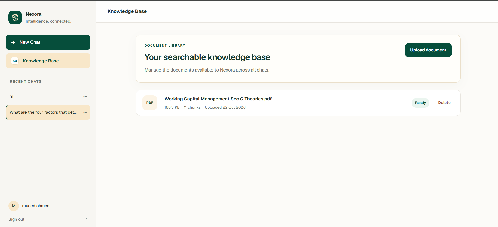
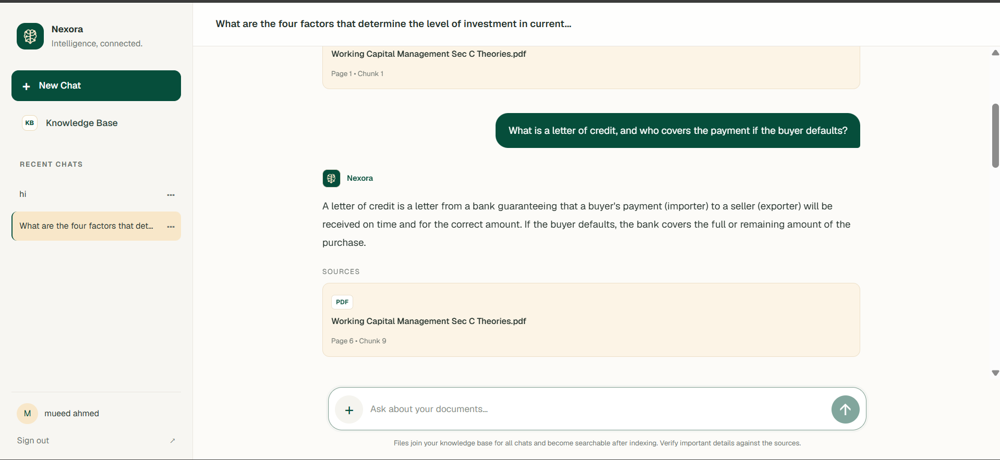
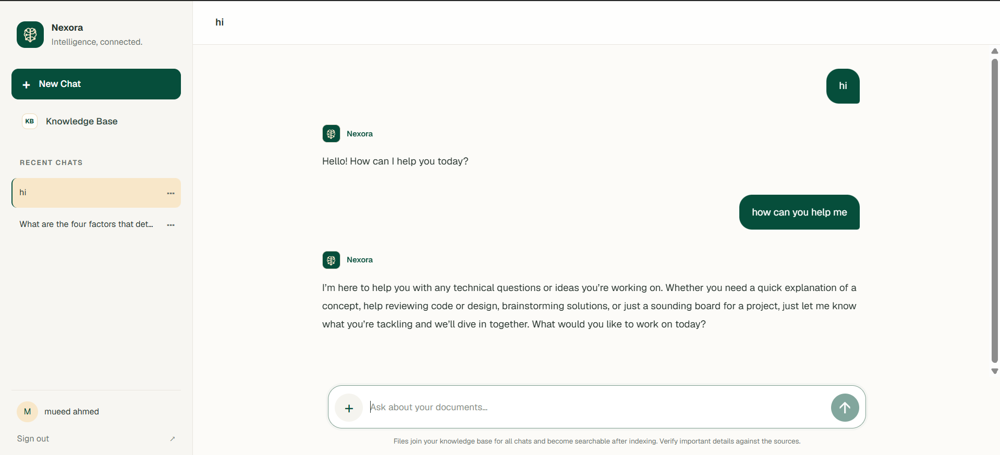
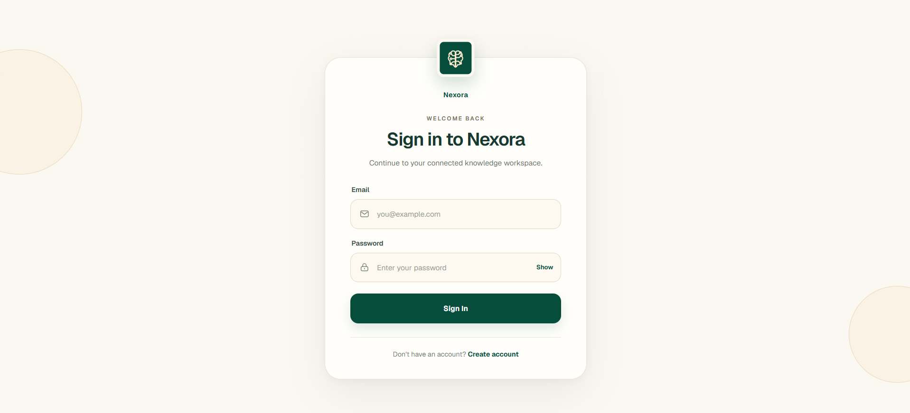
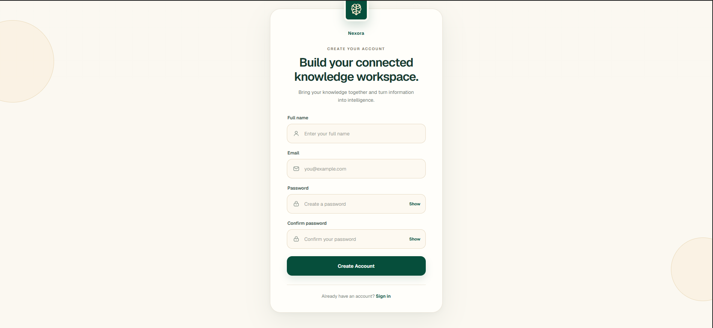
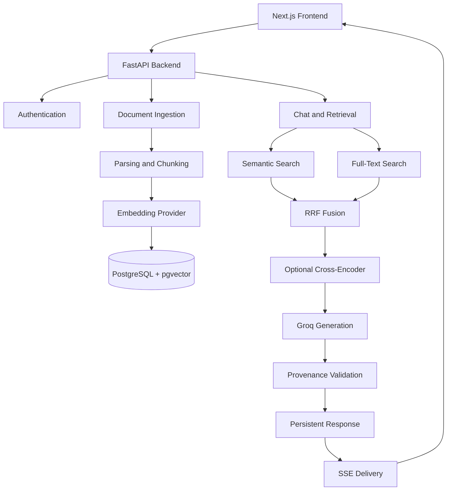

# Nexora

### Intelligence, connected.

**Nexora is an AI-Powered Knowledge Intelligence Platform** built with FastAPI, Next.js, PostgreSQL/pgvector, Gemini and local Nomic embeddings, hybrid retrieval, and Groq structured generation.

Upload your documents, build a personal knowledge base, and interact with your information through conversational AI.

**Live Demo:** https://nexora-azure-two.vercel.app/

**Backend API:** https://nexora-h21g.onrender.com

---

## Features

- **Secure authentication:** Email/password authentication, short-lived JWT access tokens, rotating refresh sessions, and HttpOnly cookies.
- **Document ingestion:** Per-user PDF, TXT, and Markdown uploads with asynchronous parsing, chunking, and embedding.
- **Hybrid retrieval:** pgvector semantic search combined with PostgreSQL full-text search.
- **Reciprocal Rank Fusion:** Combines semantic and lexical search results.
- **Optional reranking:** Local cross-encoder reranking.
- **Conversational RAG:** Persistent conversations, follow-up question rewriting, and bounded chat history.
- **Source-grounded answers:** Backend-validated structured provenance, trusted source cards, and separated supplemental guidance.
- **Knowledge Base:** Document status, metadata management, and deletion.
- **Progressive delivery:** Validated SSE responses through a responsive Next.js interface.

---

## Screenshots

### Knowledge Base



### AI Chat with Source Citations



### Welcome Screen



### Authentication

| Sign In | Create Account |
|---|---|
|  |  |

---

## Architecture



### RAG Pipeline

1. **Upload:** An authenticated user uploads a supported document.
2. **Processing:** The API accepts the upload with HTTP `202` and schedules background processing.
3. **Chunking:** Documents are parsed and divided into smaller chunks.
4. **Embedding:** Chunks are converted into vectors using the configured embedding provider.
5. **Retrieval:** Semantic and lexical search retrieve relevant chunks.
6. **Fusion:** Reciprocal Rank Fusion combines retrieval candidates.
7. **Reranking:** An optional local cross-encoder reranks the candidates.
8. **Generation:** Retrieved context is sent to Groq for structured answer generation.
9. **Validation:** The backend validates provenance before persisting and returning the response.
10. **Delivery:** The validated Markdown is progressively delivered through Server-Sent Events.

**Streaming behavior:** Generation and provenance validation finish before SSE delivery begins. This provides progressive answer display, not time-to-first-token generation streaming.

---

## Repository Structure

| Path | Purpose |
|---|---|
| `backend/app` | FastAPI routes, authentication, ingestion, retrieval, generation, and persistence |
| `backend/alembic` | PostgreSQL and pgvector schema migrations |
| `backend/evaluation` | Versioned deterministic RAG evaluation cases |
| `backend/test_*.py` | Backend unit and integration tests |
| `frontend/src` | Next.js App Router application and shared UI components |
| `frontend/tests` | Playwright browser tests |
| `docker-compose.yml` | Local full-stack environment |
| `render.yaml` | Render backend service configuration |
| `screenshots/` | Project interface screenshots |

---

## Technology Stack

| Layer | Technologies |
|---|---|
| Frontend | Next.js, React, TypeScript, Tailwind CSS |
| Backend | Python, FastAPI |
| Database | PostgreSQL, pgvector |
| ORM | SQLAlchemy |
| Migrations | Alembic |
| Authentication | JWT, Argon2 password hashing, refresh sessions |
| Embeddings | Gemini, Nomic |
| Retrieval | Vector Search, PostgreSQL Full-Text Search, RRF |
| Reranking | Sentence Transformers, Cross-Encoder |
| LLM | Groq |
| Streaming | Server-Sent Events |
| Deployment | Vercel, Render, Neon PostgreSQL |
| Testing | unittest, Playwright |

---

## Local Setup

### Prerequisites

- Python 3.13.3 (local development environment)
- Node.js and npm
- PostgreSQL with pgvector, or Docker Desktop

### 1. Backend Setup

Open a terminal in the `backend` directory.

Create a virtual environment:

```powershell
python -m venv venv
```

Activate it:

```powershell
.\venv\Scripts\Activate.ps1
```

Install local dependencies:

```powershell
pip install -r requirements.txt
```

Create `backend/.env` using `.env.example` and configure your database and API credentials.

Apply database migrations:

```powershell
alembic upgrade head
```

Start the backend:

```powershell
uvicorn app.main:app --reload
```

### 2. Frontend Setup

Open another terminal:

```powershell
cd frontend
npm ci
npm run dev
```

The application will be available at:

- Frontend: http://localhost:3000
- Backend: http://localhost:8000
- API documentation: http://localhost:8000/docs
- Health check: http://localhost:8000/health

### Embedding Configuration

The local `.env.example` selects:

- `EMBEDDING_PROVIDER=nomic_local`
- `RERANKER_PROVIDER=local`

To use hosted Gemini embeddings locally:

```env
EMBEDDING_PROVIDER=gemini
RERANKER_PROVIDER=none
```

Provide `GEMINI_API_KEY` when using Gemini.

---

## Docker

Copy `.env.example` to `.env` and replace placeholder secrets.

Build and start the application:

```powershell
docker compose build
docker compose up -d
```

Check running services:

```powershell
docker compose ps
```

View backend logs:

```powershell
docker compose logs -f backend
```

Stop the stack:

```powershell
docker compose down
```

Use `docker compose down -v` only when you intentionally want to delete database and model-cache volumes.

The Docker bootstrap enables the PostgreSQL vector extension and applies Alembic migrations before starting Uvicorn.

The Dockerfile defaults to `requirements-cloud.txt`, which excludes PyTorch and sentence-transformers. The local Compose configuration uses the local dependency setup.

---

## Configuration

### Backend Environment Variables

| Variable | Purpose |
|---|---|
| `DATABASE_URL` | PostgreSQL connection URL |
| `JWT_SECRET_KEY` | JWT signing secret |
| `GROQ_API_KEY` | Groq API key |
| `GROQ_MODEL` | Groq generation model |
| `POSTGRES_PASSWORD` | PostgreSQL password for Compose |
| `GEMINI_API_KEY` | Required for Gemini embeddings |
| `GEMINI_EMBEDDING_MODEL` | Gemini embedding model |
| `EMBEDDING_REQUEST_TIMEOUT_SECONDS` | Embedding request timeout |
| `EMBEDDING_BATCH_SIZE` | Embedding batch size |
| `RERANKER_PROVIDER` | `none` or `local` |
| `CORS_ORIGINS` | Allowed frontend origins |

### Frontend Environment Variables

| Variable | Purpose |
|---|---|
| `NEXT_PUBLIC_API_URL` | Backend API base URL |

`NEXT_PUBLIC_API_URL` is compiled into the frontend build, so redeploy the frontend after changing it.

Never commit API keys, database credentials, or JWT secrets.

---

## Deployment: Vercel + Render + Neon

Nexora uses three deployment platforms:

| Component | Platform |
|---|---|
| Frontend | Vercel |
| Backend | Render |
| Database | Neon PostgreSQL |

### 1. Model Memory Constraints

The local embedding and reranking models have significant memory requirements.

Measured on the development machine:

| Stage | Resident Memory |
|---|---:|
| Process baseline | 15 MiB |
| ML imports | 380 MiB |
| Nomic loaded and warmed | 922 MiB |
| Nomic + cross-encoder loaded and warmed | 1,022 MiB |

These measurements make the local model stack unsuitable for the Render Free memory limit.

The cloud configuration therefore uses:

- Gemini `gemini-embedding-001`
- 768-dimensional embeddings
- RRF retrieval
- `RERANKER_PROVIDER=none`

The cloud application avoids loading PyTorch and local reranking weights.

### 2. Gemini Embedding Configuration

Gemini uses:

- `RETRIEVAL_DOCUMENT` for document chunks.
- `RETRIEVAL_QUERY` for user queries.
- 768-dimensional vectors.
- L2 normalization.
- Vector validation for incorrect dimensions, zero values, NaN, and infinity.
- Configured request timeouts and bounded retry/backoff for transient errors.

Gemini free-tier availability and quotas depend on the Google project and may change.

### 3. Embedding-Space Migration

Nomic and Gemini embeddings are incompatible even though both use 768 dimensions.

Migration `f2c31a8bd420` records:

- `embedding_provider`
- `embedding_model`

Retrieval requires an exact match with the active embedding identity.

After changing embedding providers, existing documents must be explicitly reindexed.

Run from `backend`:

```powershell
.\venv\Scripts\python.exe -m alembic upgrade head
.\venv\Scripts\python.exe -m app.rag.reindex --all --yes
```

For selected documents:

```powershell
.\venv\Scripts\python.exe -m app.rag.reindex --document-id 12 --document-id 27 --yes
```

The reindex process:

1. Generates embeddings for stored chunk text.
2. Acquires database locks.
3. Verifies that documents and chunks have not changed.
4. Replaces vectors and embedding identity transactionally.

Failures leave the previous vectors and identity intact. Reindexing does not run automatically during application startup.

Use `--force` only when intentionally regenerating documents already using the active embedding identity.

### 4. Neon PostgreSQL

1. Create a Neon project.
2. Copy the pooled connection string.
3. Set Render's `DATABASE_URL`.
4. Retain `sslmode=require`.
5. Keep the small database pool configuration.

Recommended cloud settings:

```env
DATABASE_POOL_SIZE=3
DATABASE_MAX_OVERFLOW=2
DATABASE_POOL_RECYCLE_SECONDS=300
```

The container runs:

```bash
python -m app.db_bootstrap
alembic upgrade head
```

This enables pgvector and applies database migrations before the API starts.

### 5. Render Backend

The repository includes `render.yaml` and `backend/Dockerfile`.

Render uses Docker with Python 3.11-slim.

The Dockerfile installs:

```dockerfile
ARG REQUIREMENTS_FILE=requirements-cloud.txt
```

The cloud dependency file excludes local ML dependencies.

Configure these environment variables in Render:

- `DATABASE_URL`
- `JWT_SECRET_KEY`
- `GROQ_API_KEY`
- `GEMINI_API_KEY`
- `CORS_ORIGINS`
- `GROQ_MODEL`
- `EMBEDDING_PROVIDER=gemini`
- `GEMINI_EMBEDDING_MODEL=gemini-embedding-001`
- `RERANKER_PROVIDER=none`

The container honors Render's injected `PORT` and exposes `/health`.

Render Free services may spin down when inactive. In-process background tasks can also be interrupted by service restarts.

### 6. Vercel Frontend

1. Import the GitHub repository into Vercel.
2. Set the Root Directory to `frontend`.
3. Configure `NEXT_PUBLIC_API_URL` with the Render backend URL.
4. Deploy the frontend.

The browser sends refresh cookies directly to Render.

For cross-site frontend/API deployments, configure:

```env
COOKIE_SECURE=true
COOKIE_SAMESITE=none
```

CORS must allow the exact frontend origin with credentials enabled.

Some browsers and privacy modes restrict third-party cookies. Custom domains under the same registrable domain, such as `app.example.com` and `api.example.com`, can avoid this dependency.

For preview deployments, use explicit allowed origins or a tightly anchored CORS origin regex. Never use `*` with credentialed requests.

---

## Testing

### Backend

Run from `backend`:

```powershell
.\venv\Scripts\python.exe -m compileall app
```

Run backend tests:

```powershell
.\venv\Scripts\python.exe -m unittest discover -p "test_*.py" -v
```

### Frontend

Run from `frontend`:

```powershell
npm run lint
npm run build
npx playwright test
```

Live external-service integration tests are opt-in through their documented environment variables. Unit tests mock Gemini and do not consume API quota.

---

## RAG Evaluation

The project includes versioned evaluation cases in:

```text
backend/evaluation/cases.json
```

Evaluation helpers in `app/evaluation.py` include:

- Recall@K
- Expected-fact checks
- Citation-validity checks

Run deterministic evaluation tests from `backend`:

```powershell
python -m unittest test_evaluation -v
```

Live answer evaluation requires a representative uploaded document corpus.

No benchmark score is claimed in this repository.

---

## Known Limitations

- **Background processing:** FastAPI background tasks are not durable. A restart can interrupt processing, and users may need to upload affected documents again.
- **Progressive SSE:** Delivery begins after generation and provenance validation, so it does not reduce time to first generated token.
- **Browser disconnects:** Responses committed before SSE delivery remain in chat history and can be reconciled from stored conversations.
- **Gemini quotas:** Availability and rate limits may change. A full document reindex and real production quota test are not covered by unit tests.
- **Cloud reranking:** The cloud configuration disables the local cross-encoder and uses RRF ordering.
- **Production readiness:** Backups, centralized logs and metrics, alerting, gateway rate limiting, and CI/CD remain important future improvements.

---

## Project Goal

Nexora explores the practical engineering challenges of building and deploying a full-stack Retrieval-Augmented Generation system.

The project focuses on more than simply generating answers from documents. It brings together document ingestion, embedding management, hybrid retrieval, source validation, authentication, persistent conversations, deployment optimization, and evaluation.

**Nexora — Intelligence, connected.**